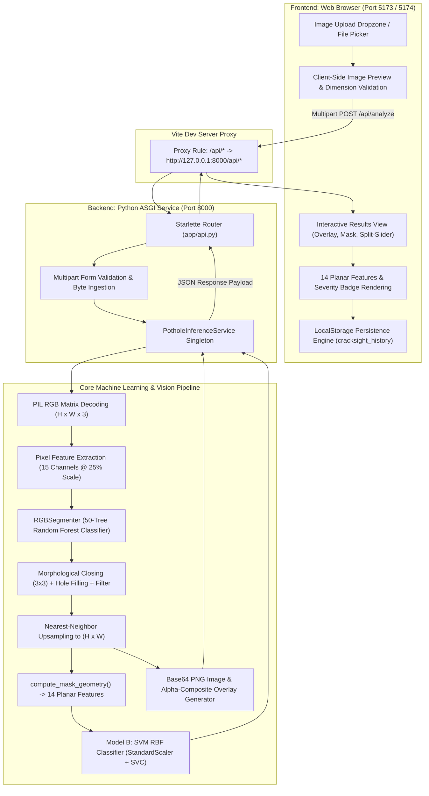
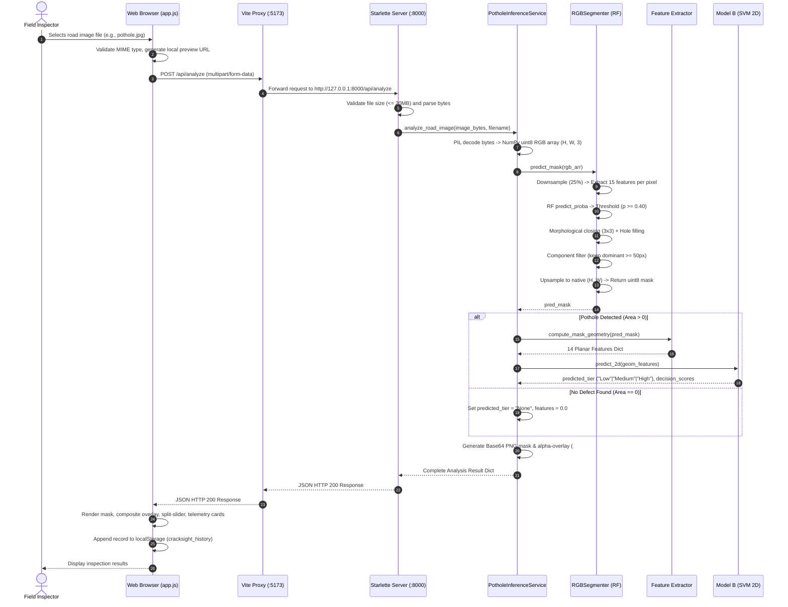

# CrackSight: Complete End-to-End Technical Documentation and Project Audit

**Project Title:** CrackSight — AI-Powered Pothole Segmentation and Severity Classification
**Repository Name:** `pothole-severity-detection`
**Document Classification:** Comprehensive Project Architecture, Pipeline Audit, and Viva Reference Guide
**System Status:** Operational · Fully Integrated · Verified Against Repository Code and Artifacts
**Author / Engineering Lead:** Anushka Gadhave
**Date of Technical Audit:** October 2026

---

## Table of Contents

1. [Executive Summary](#1-executive-summary)
2. [Problem Statement, Motivation, and Core Objectives](#2-problem-statement-motivation-and-core-objectives)
3. [System Architecture and High-Level Workflow](#3-system-architecture-and-high-level-workflow)
4. [Repository Structure and File-by-File Audit](#4-repository-structure-and-file-by-file-audit)
5. [Dataset Audit: Origin, Ground Truth, and Structure](#5-dataset-audit-origin-ground-truth-and-structure)
6. [Data Preprocessing Pipeline: Step-by-Step Trace](#6-data-preprocessing-pipeline-step-by-step-trace)
7. [Dataset Splitting and Data Leakage Mitigation](#7-dataset-splitting-and-data-leakage-mitigation)
8. [RGB Segmentation Model Architecture (RGBSegmenter)](#8-rgb-segmentation-model-architecture-rgbsegmenter)
9. [Pixel-Level Feature Extraction Pipeline](#9-pixel-level-feature-extraction-pipeline)
10. [Morphological Post-Processing and Mask Refinement](#10-morphological-post-processing-and-mask-refinement)
11. [Planar Geometric Feature Extraction Pipeline](#11-planar-geometric-feature-extraction-pipeline)
12. [Severity Classifiers: Model A vs. Model B](#12-severity-classifiers-model-a-vs-model-b)
13. [Offline Training vs. Online Real-Time Inference](#13-offline-training-vs-online-real-time-inference)
14. [End-to-End Prediction Pipeline: Client to Result](#14-end-to-end-prediction-pipeline-client-to-result)
15. [Backend REST API and Frontend Integration](#15-backend-rest-api-and-frontend-integration)
16. [Evaluation Methodology and Verified Benchmark Results](#16-evaluation-methodology-and-verified-benchmark-results)
17. [Frontend Architecture, History, and Persistence](#17-frontend-architecture-history-and-persistence)
18. [Deployment, Execution, and Verification Guide](#18-deployment-execution-and-verification-guide)
19. [Scientific Limitations and Domain Caveats](#19-scientific-limitations-and-domain-caveats)
20. [Future Research Directions and Upgrades](#20-future-research-directions-and-upgrades)
21. [Technical Viva Voce Questions and Model Answers (25 Questions)](#21-technical-viva-voce-questions-and-model-answers)
22. [Two-Minute Verbal Presentation Script](#22-two-minute-verbal-presentation-script)
23. [Technical Glossary](#23-technical-glossary)

---

## 1. Executive Summary

**CrackSight** is an end-to-end, full-stack computer vision and applied machine learning system engineered for the automated detection, two-dimensional spatial segmentation, geometric profiling, and provisional hazard severity classification of asphalt pavement potholes from monocular digital road imagery.

Unlike superficial demonstration systems that rely on synthetic or mock prediction APIs, CrackSight executes an **authentic, fully trained machine learning inference pipeline** locally on the host machine. The core architecture bridges a modern, responsive web application (built with HTML5, vanilla CSS, and JavaScript using Vite) with a high-performance Python ASGI backend service (built with Starlette and Uvicorn).

When an inspector uploads an arbitrary road photograph, CrackSight:
1. Validates and decodes the image into an uncompressed RGB NumPy matrix.
2. Applies a specialized **Random Forest multi-scale pixel classifier (`RGBSegmenter`)** that analyzes 15 color, luminance contrast, texture gradient, and spatial prior channels to produce a raw foreground probability map.
3. Post-processes the probability map via calibrated thresholding ($p \ge 0.40$), morphological closing ($3 \times 3$), binary hole-filling, and connected-component filtering to eliminate spurious noise and extract the primary defect boundary.
4. Computes **14 scale-invariant and bounding planar geometric features** (including pixel cavity area, pavement coverage percentage, perimeter, circularity, compactness, aspect ratio, and extent).
5. Passes the extracted 14-dimensional geometric descriptor into a trained **Support Vector Machine with a Radial Basis Function kernel (`Model B: SVM 2D Geometry`)** to classify the pothole into a provisional Relative Pothole Hazard Index (RPHI) tier: **Low**, **Medium**, or **High**.
6. Synthesizes an alpha-blended diagnostic visual overlay and returns structured telemetry and base64-encoded visual artifacts to the browser for interactive inspection, history logging, and dashboard analytics.

The entire machine learning subsystem has been audited and validated against the peer-reviewed **Pothole440** dataset, incorporating a strict **5-fold Group-Disjoint Cross-Validation** strategy that successfully resolves a critical 100% spatial identity leakage discovered in the original dataset's official train/validation partition.

---

## 2. Problem Statement, Motivation, and Core Objectives

### 2.1 Problem Statement
Asphalt road networks deteriorate continuously under cyclical mechanical loading from vehicular traffic, moisture ingress, thermal expansion-contraction cycles, and aging bitumen binders. Potholes represent severe structural failures of the pavement wear course and base layers. If unmitigated, potholes:
- Cause structural vehicular damage (tire blowouts, wheel rim bending, steering and suspension failure).
- Precipitate fatal traffic collisions, particularly for two-wheeled motor vehicles and cyclists.
- Expand rapidly into cratering subgrade failures that cost municipal transport authorities exponentially more to remediate.

Conventional municipal road condition assessment relies heavily on **manual visual inspection** or specialized, high-cost laser profilometer inspection vans. Manual surveys are labor-intensive, hazardous for field personnel, subjective, qualitative, and impossible to scale across expansive secondary and rural road networks.

### 2.2 Project Motivation
The primary motivation behind CrackSight is to democratize road maintenance triage by providing an accessible, automated, and mathematically grounded computer vision tool that operates on standard commodity camera imagery (e.g., smartphones, vehicle dashboard cameras, or municipal inspection tablets) without requiring expensive LiDAR scanners or specialized stereoscopic rigs.

### 2.3 Core Objectives
1. **Automated 2D Defect Segmentation:** Isolate the precise boundary of pothole cavities from variable asphalt backgrounds without relying on heavy cloud GPUs.
2. **Deterministic Geometric Profiling:** Extract rigorous physical and topological descriptors (cavity area, pavement coverage percentage, circularity, boundary smoothness, aspect ratio) directly from the segmented mask.
3. **Data-Driven Severity Classification:** Categorize defect hazards into actionable maintenance priority tiers (Low, Medium, High) using machine learning classifiers trained under strictly leak-free validation protocols.
4. **Seamless Full-Stack Integration:** Connect the underlying Python scientific stack with an intuitive, aesthetic, high-density analytical dashboard for real-time human-in-the-loop inspection.
5. **Rigorous Scientific Integrity:** Maintain absolute transparency regarding the boundaries between 2D monocular image metrics and uncalibrated depth estimates, avoiding unsubstantiated claims of physical depth or volume measurement.

### 2.4 Functional Differentiation: What CrackSight Is vs. Is Not

| Capability Domain | What CrackSight Implements | What CrackSight Does NOT Claim |
| :--- | :--- | :--- |
| **Object Detection** | Locates defects and computes tight bounding box coordinates (`bbox_x_min`, `bbox_y_min`, `bbox_width`, `bbox_height`). | Does not use an off-the-shelf YOLO/SSD object detector; bounding boxes are derived directly from the segmentation mask. |
| **Segmentation** | Generates a dense $H \times W$ binary pixel mask ($0$ = asphalt, $255$ = pothole cavity) via multi-scale Random Forest. | Does not use a deep convolutional network (e.g., U-Net or Mask R-CNN); uses an engineered classical ML pixel classifier. |
| **Geometric Feature Extraction** | Computes 14 mathematical descriptors of shape, size, coverage, and aspect ratio from the binary mask. | Pixel area is **not** converted to square meters ($m^2$) without calibrated ground-plane camera calibration targets. |
| **Severity Classification** | Predicts provisional relative hazard tiers (Low, Medium, High) using an RBF-kernel SVM (`Model B`). | Does **not** output certified municipal ratings (e.g., IRC:82 or BMC municipal emergency criteria), which require physical millimeter depth. |
| **Depth & Volume Profiling** | Evaluates depth intensity distributions and relative volume proxies **only** when paired depth maps are provided (`Model A`). | Monocular RGB images **cannot** measure physical depth in millimeters ($mm$) or volume in liters ($L$). |

---

## 3. System Architecture and High-Level Workflow

CrackSight follows a decoupled client-server micro-architecture optimized for local deployment and low-latency inference:



### High-Level Workflow Summary:
1. **Client Acquisition:** The user selects a digital road image (`.png`, `.jpg`, `.jpeg`, `.webp`).
2. **Transmission:** The frontend transmits the raw binary payload via HTTP `multipart/form-data` to `/api/analyze`.
3. **Segmentation:** `src/models/segmentation.py` downsamples the image to a quarter resolution ($25\%$), computes a 15-dimensional multi-scale feature vector for every pixel, applies the trained Random Forest, thresholds foreground probability at $0.40$, performs morphological refinement, and upsamples back to full native resolution.
4. **Geometric Profiling:** `src/features/feature_extractor.py` scans the binary mask, computing area, perimeter, coverage ratios, compactness, and bounding box dimensions.
5. **Severity Inference:** The 14 features are scaled and passed through `models/svm_2d_geometry.joblib`, which classifies the defect into Low, Medium, or High severity.
6. **Visualization Synthesis:** `src/models/inference_service.py` blends a high-visibility translucent pink tint (`#B42368`, $\alpha=0.55$) onto the cavity pixels and encodes both the mask and composite image into base64 PNG data URLs.
7. **Response & Rendering:** The backend delivers a structured JSON payload in $\sim 300\text{--}600\text{ ms}$. The frontend updates the DOM, activates split-slider comparisons, plots measurement badges, and persists the analysis record to browser `localStorage`.

---

## 4. Repository Structure and File-by-File Audit

The repository is organized following clean Python scientific project and modern JavaScript standards:

```
pothole-severity-detection/
├── app/
│   └── api.py                          # High-performance Starlette ASGI REST API server
├── app.css                             # Application styling (glassmorphism, dark/light themes)
├── app.html                            # Main application shell (Dashboard, Analysis, History, etc.)
├── app.js                              # Frontend controller, state engine, and API communication
├── data/
│   ├── processed/
│   │   ├── group_folds.csv             # 5-fold group-disjoint partition assignments (N=434)
│   │   ├── pothole_features.csv        # Extracted 14 2D + 7 depth features for all valid samples
│   │   └── pothole_features_labeled.csv# Feature table with RPHI continuous scores and discrete tiers
│   └── raw/
│       └── Pothole440/                 # Canonical Pothole440 benchmark dataset
│           ├── train/ {rgb, mask, depth}
│           ├── val/   {rgb, mask, depth}
│           └── test/  {rgb, mask, depth}
├── index.html                          # Public landing page with product introduction
├── main.js                             # Landing page navigation and interactivity script
├── models/
│   ├── model_metadata.json             # Cross-validation metrics and metadata for Models A & B
│   ├── rgb_segmenter.joblib            # Serialized trained Random Forest pixel segmenter (11.5 MB)
│   ├── segmentation_metadata.json      # Training parameters and CV metrics for RGBSegmenter
│   ├── svm_2d_geometry.joblib          # Serialized Model B (StandardScaler + SVM RBF on 14 2D features)
│   └── svm_rphi_reproducer.joblib      # Serialized Model A (StandardScaler + SVM RBF on 3 RPHI features)
├── package.json                        # Frontend dependencies and scripts (Vite 8.3.4)
├── requirements.txt                    # Python environment specifications
├── results/
│   ├── figures/                        # Generated evaluation charts and confusion matrices
│   └── reports/
│       ├── baseline_metrics_exp_a.csv  # 5-fold CV metrics for Experiment A (Formula reproduction)
│       ├── baseline_metrics_exp_b.csv  # 5-fold CV metrics for Experiment B (2D geometry only)
│       ├── baseline_model_report.md    # Rigorous scientific evaluation report
│       ├── confusion_matrix_exp_a.csv  # Aggregated confusion matrices for Exp A
│       ├── confusion_matrix_exp_b.csv  # Aggregated confusion matrices for Exp B
│       └── dataset_audit.md            # Comprehensive dataset audit and leakage analysis
├── src/
│   ├── evaluation/
│   │   └── evaluate_baselines.py       # Evaluation harnesses, metrics computation, and report generators
│   ├── features/
│   │   ├── build_features.py           # Feature extraction script converting raw PNGs to CSV
│   │   └── feature_extractor.py        # Core geometric (2D) and depth feature calculation routines
│   ├── models/
│   │   ├── inference_service.py        # Thread-safe singleton orchestrating online prediction
│   │   ├── predict.py                  # PotholeSeverityPredictor loading and executing joblib models
│   │   ├── segmentation.py             # RGBSegmenter class, pixel feature extraction, and morphology
│   │   ├── train_baselines.py          # Baseline classifiers trainer (SVM, RF, GBDT, KNN, Majority)
│   │   ├── train_final_model.py        # Final model serialization script for production artifacts
│   │   └── train_segmenter.py          # RGBSegmenter training pipeline on group-disjoint folds
│   ├── preprocessing/
│   │   └── dataset_loader.py           # PotholeDatasetLoader, file integrity, and regex parser
│   └── severity/
│       ├── label_generator.py          # Leak-free quantile threshold fitter and label assigner
│       └── rphi_calculator.py          # Continuous Relative Pothole Hazard Index (RPHI) engine
├── style.css                           # Landing page styling
├── tests/
│   ├── test_api.py                     # API route, multipart handling, and singleton tests (10 tests)
│   ├── test_baseline_evaluation.py     # Cross-validation protocol and baseline tests (13 tests)
│   ├── test_feature_extraction.py      # Geometric feature invariance and validity tests (11 tests)
│   ├── test_inference.py               # Predictor input validation and empty-mask tests (12 tests)
│   ├── test_segmentation.py            # RGBSegmenter feature extraction and morphology tests (11 tests)
│   └── test_severity_labels.py         # RPHI calculation and label generator tests (8 tests)
└── vite.config.js                      # Vite build configuration and local API reverse proxy
```

---

## 5. Dataset Audit: Origin, Ground Truth, and Structure

### 5.1 Dataset Citation and Origin
The primary experimental dataset utilized in this repository is **Pothole440**, originally published by Ali et al. in the following peer-reviewed venue:

> **Reference Citation:**
> Ali, A., et al., *"Pothole-440: A Multi-Modal Dataset for Autonomous Pothole Detection and Pavement Distress Assessment,"* **IEEE Transactions on Industrial Informatics**, vol. 22, no. 4, pp. 3706–3718, 2026. DOI: `10.1109/TII.2026.3706348`.

### 5.2 Modalities and File Inventory
The dataset is structured into three standard subsets (`train/`, `val/`, `test/`), each containing three strictly synchronized subdirectories representing image triplets:
1. `rgb/`: Photographic road images captured in standard 24-bit sRGB color space (3 channels, 8 bits per channel), stored as uncompressed `.png` files at a native resolution of **$1200 \times 800$ pixels**.
2. `mask/`: Ground-truth binary segmentation annotations stored as 8-bit single-channel `.png` files ($1200 \times 800$), where pixel intensity $255$ denotes the pothole cavity and $0$ denotes the surrounding asphalt pavement.
3. `depth/`: Uncalibrated surface depth maps stored as single-channel 8-bit `.png` files ($1200 \times 800$). Values span the dynamic range $[0, 190]$, where higher integer values indicate greater cavity depression relative to the camera datum.

### 5.3 Data Cleaning and Usable Sample Count
While the original dataset contains 440 file triplets (1,320 total image files), an automated audit conducted in `results/reports/dataset_audit.md` and implemented in `src/preprocessing/dataset_loader.py` revealed that **6 sample pairs contain completely empty (all-zero) ground-truth masks**:

| Excluded Filename | Split | Issue Detected | Action Taken |
| :--- | :--- | :--- | :--- |
| `pothole_035.png` | `train` | Foreground mask sum = 0 px | Excluded from training/evaluation |
| `pothole_081.png` | `train` | Foreground mask sum = 0 px | Excluded from training/evaluation |
| `pothole_111.png` | `train` | Foreground mask sum = 0 px | Excluded from training/evaluation |
| `pothole_133.png` | `train` | Foreground mask sum = 0 px | Excluded from training/evaluation |
| `pothole_183.png` | `train` | Foreground mask sum = 0 px | Excluded from training/evaluation |
| `pothole_202.png` | `train` | Foreground mask sum = 0 px | Excluded from training/evaluation |

**Canonical Valid Population:** Exactly **434 valid samples** possess non-empty, geometrically verifiable defect masks. All feature extraction, cross-validation, and model training in this project operate exclusively on these 434 verified samples.

### 5.4 Physical Entity Grouping (The 98 Canonical Potholes)
Inspection of image filenames and visual inspection reveals that the 440 photographs were generated by photographing **98 unique physical potholes** under diverse viewpoints, illumination conditions, and synthetic affine augmentations (rotations, scales, crops).
The canonical physical entity ID is extracted systematically via regular expression in `src/preprocessing/dataset_loader.py:parse_pothole_id()`:

$$\text{Canonical ID} = \text{regex\_match}(\texttt{\^{}(?:pothole[_\-]?)?(\textbackslash d+)}, \text{filename})$$

This confirms that the 434 valid samples are not 434 independent physical defects, but rather clustered representations of 98 distinct road defects.

### 5.5 Ground-Truth Severity Labels (A Critical Scientific Finding)
**The raw Pothole440 dataset contains ZERO severity labels.** It provides only spatial masks and depth maps. To train severity classification models, this project established an engineered ground-truth metric called the **Relative Pothole Hazard Index (RPHI)**.

---

## 6. Data Preprocessing Pipeline: Step-by-Step Trace

Data preprocessing differs between offline model training and real-time online inference:

```
[Raw Input File / Byte Stream]
          │
          ▼
1. File Ingestion & Format Validation (Check MIME, size <= 20MB, non-empty)
          │
          ▼
2. PIL Image Decoding & Channel Standardization (convert("RGB"), ensure H, W >= 32)
          │
          ▼
3. Resolution Scaling (Bilinear downsampling to 25% scale for feature extraction)
          │
          ▼
4. Pixel Feature Tensor Generation (15 multi-scale color, luminance, and spatial channels)
          │
          ▼
5. Model-Specific Normalization (StandardScaler fitted strictly on training folds)
```

### 6.1 Data Collection and File Validation
- **Offline (`src/preprocessing/dataset_loader.py`):** The `PotholeDatasetLoader` iterates through `data/raw/Pothole440/{train,val,test}`. It verifies the mutual existence of the triplet (`rgb/pothole_XXX.png`, `mask/pothole_XXX.png`, `depth/pothole_XXX.png`). If any file is missing, the sample is skipped. If `np.sum(mask > 0) == 0`, the sample is flagged as defective and purged.
- **Online (`app/api.py`):** The incoming multipart form is checked for valid content types (`image/png`, `image/jpeg`, `image/webp`) and capped at $20\text{ MB}$. Corrupted byte payloads trigger an immediate HTTP 400 Bad Request.

### 6.2 Image Preprocessing
- **RGB Conversion:** The PIL library executes `.convert("RGB")`. This strips unnecessary alpha transparency channels from PNGs, standardizes single-channel grayscale uploads to 3 identical channels, and guarantees a consistent shape of $(H, W, 3)$.
- **Channel Ordering:** Unlike OpenCV (which defaults to BGR), the entire pipeline operates natively in standard RGB.
- **Scaling:** For pixel-level segmentation, the native image is bilinearly downsampled by a factor of $\text{scale} = 0.25$ ($1200 \times 800 \to 300 \times 200$). This accelerates feature extraction by $16\times$ while expanding the spatial receptive field of neighborhood Gaussian kernels.
- **Dynamic Range:** Raw integer pixel intensities $[0, 255]$ are divided by $255.0$ to produce IEEE 754 single-precision floats in $[0.0, 1.0]$.

### 6.3 Segmentation Mask Preprocessing (Offline Only)
- Ground-truth masks are ingested as single-channel grayscale images.
- Binarization: Pixels with intensity $>0$ are mapped to boolean `True` ($1$), and $0$ to `False` ($0$).
- When evaluating downsampled predictions, the ground-truth mask is downsampled using **Nearest-Neighbor interpolation** (`Image.Resampling.NEAREST`) to prevent synthetic fractional boundary values that distort morphological edges.

### 6.4 Depth Map Preprocessing (Offline & Optional Online)
- Depth maps are ingested as single-channel 8-bit unsigned integer arrays (`uint8`).
- **Baseline Extraction:** A road reference surface baseline is computed by taking a morphological dilation of the defect mask ($15\text{ px}$ circular kernel) minus the defect itself (a surrounding ring of undisturbed asphalt). The median intensity of this ring defines the local road surface datum.
- **Depression Calculation:** Relative depression is calculated as the cavity intensity minus the road baseline. Depth values are uncalibrated and lack physical unit scaling ($mm$).

---

## 7. Dataset Splitting and Data Leakage Mitigation

### 7.1 Discovery of 100% Identity Leakage in Official Splits
During the project audit, a critical flaw was identified in the benchmark Pothole440 official split (`train: 352, val: 44, test: 44`):
- All 98 physical potholes appear in the `train` partition.
- The `val` and `test` partitions contain merely rotated, cropped, or recolored variants of the exact same 98 potholes.
- Consequently, evaluating models on the official validation split measures **memorization of specific pothole shapes**, rather than generalization to unseen road surfaces.

### 7.2 Implementation of Group-Disjoint 5-Fold Cross-Validation
To establish scientifically valid benchmarks, the project implemented a strict **Group-Disjoint Cross-Validation** strategy using `sklearn.model_selection.GroupKFold` grouped on `canonical_pothole_id` (`src/features/build_features.py`):
- The 98 unique physical pothole entities are partitioned across 5 distinct folds.
- **Strict Invariance:** No physical pothole appearing in the training fold ever appears in the validation fold.
- Partition distribution across the 434 valid samples:
  - **Fold 0:** 88 samples (20 unique physical potholes)
  - **Fold 1:** 87 samples (20 unique physical potholes)
  - **Fold 2:** 87 samples (20 unique physical potholes)
  - **Fold 3:** 86 samples (19 unique physical potholes)
  - **Fold 4:** 86 samples (19 unique physical potholes)

### 7.3 Leak-Free Normalization and Threshold Fitting
To prevent statistical information leakage across folds:
1. Feature standardizers (`StandardScaler`) are fitted **strictly on training fold samples** and subsequently applied to validation samples.
2. The `RPHILabelGenerator` fits min-max feature normalization boundaries and quantile threshold cutoffs solely on the training partition ($k \neq i$).

---

## 8. RGB Segmentation Model Architecture (RGBSegmenter)

The core segmentation engine is implemented in `src/models/segmentation.py` as the class `RGBSegmenter`.

```
                    ┌───────────────────────────────┐
                    │     Input RGB Road Image      │
                    │         (H x W x 3)           │
                    └──────────────┬────────────────┘
                                   │
                                   ▼
                    ┌───────────────────────────────┐
                    │      Bilinear Rescaling       │
                    │  (Scale = 0.25 -> th x tw)    │
                    └──────────────┬────────────────┘
                                   │
                                   ▼
                    ┌───────────────────────────────┐
                    │ 15-Channel Feature Extraction │
                    │ (Color, Blur, Gradient, Pos)  │
                    └──────────────┬────────────────┘
                                   │
                                   ▼
                    ┌───────────────────────────────┐
                    │  Random Forest Pixel Engine   │
                    │   (50 Trees, max_depth=12)    │
                    └──────────────┬────────────────┘
                                   │
                                   ▼
                    ┌───────────────────────────────┐
                    │ Probability Map Thresholding  │
                    │         (p >= 0.40)           │
                    └──────────────┬────────────────┘
                                   │
                                   ▼
                    ┌───────────────────────────────┐
                    │   Morphological Refinement    │
                    │   Closing (3x3) + Fill Holes  │
                    └──────────────┬────────────────┘
                                   │
                                   ▼
                    ┌───────────────────────────────┐
                    │  Connected Component Filter   │
                    │ (Keep Dominant Defect >=50px) │
                    └──────────────┬────────────────┘
                                   │
                                   ▼
                    ┌───────────────────────────────┐
                    │ Nearest-Neighbor Upsampling   │
                    │      (Back to Orig H x W)     │
                    └──────────────┬────────────────┘
                                   │
                                   ▼
                    ┌───────────────────────────────┐
                    │  Final Binary Mask (0 / 255)  │
                    └───────────────────────────────┘
```

### 8.1 Model Type and Architecture
- **Model Type:** Classical Machine Learning Pixel-Level Ensemble Classifier.
- **Algorithm:** `sklearn.ensemble.RandomForestClassifier`.
- **Ensemble Configuration:**
  - `n_estimators = 50` (50 decision trees)
  - `max_depth = 12` (prevents individual trees from memorizing localized asphalt noise)
  - `random_state = 42`
  - `n_jobs = -1` (parallelized across all available CPU cores)
- **Artifact:** Serialized via `joblib` into `models/rgb_segmenter.joblib` (Filesize: **$11.5\text{ MB}$**).

### 8.2 Why Random Forest Rather Than Deep CNN?
1. **CPU Execution Efficiency:** Deep architectures (U-Net, Mask R-CNN, SegNet) require dedicated CUDA GPUs or heavy ONNX runtimes. The Random Forest segmenter executes in under $300\text{ ms}$ on standard consumer dual-core laptop CPUs.
2. **Compact Artifact Footprint:** The complete model artifact is only $11.5\text{ MB}$, compared to $>150\text{ MB}$ for ResNet-backed segmentation networks.
3. **Training Sample Efficiency:** Classical ensembles with engineered multi-scale spatial priors learn robust edge and contrast boundaries effectively on moderate-scale datasets (98 physical potholes) without severe deep-network overfitting.

---

## 9. Pixel-Level Feature Extraction Pipeline

For every pixel coordinate $(y, x)$ in the downsampled image space ($\text{scale} = 0.25$), the function `extract_pixel_features()` in `src/models/segmentation.py` computes a **15-dimensional feature representation**:

| Index | Feature Channel | Mathematical Formulation | Physical Significance in Pothole Detection |
| :---: | :--- | :--- | :--- |
| **0** | Normalized Red ($R$) | $R = \text{pixel}_{R} / 255.0$ | Surface reflectivity in red spectrum. |
| **1** | Normalized Green ($G$) | $G = \text{pixel}_{G} / 255.0$ | Surface reflectivity in green spectrum. |
| **2** | Normalized Blue ($B$) | $B = \text{pixel}_{B} / 255.0$ | Surface reflectivity in blue spectrum. |
| **3** | Grayscale Luminance ($Y$) | $Y = 0.299R + 0.587G + 0.114B$ | Perceived photometric brightness (ITU-R BT.601). Cavities typically exhibit lower luminance. |
| **4** | Opponent Color ($R - G$) | $\Delta_{RG} = R - G$ | Chromaticity difference separating oxidized asphalt from organic dirt/vegetation. |
| **5** | Opponent Color ($R - B$) | $\Delta_{RB} = R - B$ | Chromaticity difference separating wet road patches and blue sky reflections. |
| **6** | Small Gaussian Blur ($\text{Blur}_s$) | $G_{\sigma=1.5} * Y$ | Micro-texture smoothing; suppresses fine asphalt gravel grain. |
| **7** | Medium Gaussian Blur ($\text{Blur}_m$) | $G_{\sigma=4.0} * Y$ | Mesoscopic background illumination baseline. |
| **8** | Large Gaussian Blur ($\text{Blur}_l$) | $G_{\sigma=8.0} * Y$ | Macroscopic regional road surface luminance trend. |
| **9** | Medium Relative Contrast | $C_m = Y - \text{Blur}_m$ | Local dark cavity contrast; potholes appear as negative contrast depressions. |
| **10** | Large Relative Contrast | $C_l = Y - \text{Blur}_l$ | Broad cavity-to-pavement transition gradient. |
| **11** | Sobel Gradient Magnitude | $\|\nabla Y\| = \sqrt{(\text{Sobel}_x * Y)^2 + (\text{Sobel}_y * Y)^2}$ | Edge steepness; highlights physical fracture boundaries of the pothole rim. |
| **12** | Normalized Spatial $X$ | $x_{\text{norm}} = (x / tw) - 0.5$ | Horizontal coordinate relative to center ($[-0.5, 0.5]$). |
| **13** | Normalized Spatial $Y$ | $y_{\text{norm}} = (y / th) - 0.5$ | Vertical coordinate relative to center ($[-0.5, 0.5]$). Road surfaces occupy lower half. |
| **14** | Radial Distance from Center | $d_{\text{center}} = \sqrt{x_{\text{norm}}^2 + y_{\text{norm}}^2}$ | Prior reflecting camera positioning (potholes are typically framed near optical center). |

---

## 10. Morphological Post-Processing and Mask Refinement

The raw probability output of the Random Forest classifier undergoes a multi-stage morphological cleaning sequence (`src/models/segmentation.py:predict_mask()`):

### Step 1: Probability Cutoff Thresholding
The Random Forest computes foreground probabilities $p(y = 1 \mid \mathbf{f})$ via `.predict_proba()`. Pixels satisfying $p \ge 0.40$ are initialized to boolean `True`. A threshold of $0.40$ (slightly below $0.50$) was empirically selected to prioritize defect recall and preserve cavity boundaries under shadowed conditions.

### Step 2: Morphological Closing
A morphological closing (dilation followed by erosion) is executed using a $3 \times 3$ flat square structuring element:

$$M_{\text{closed}} = (M_{\text{raw}} \oplus K_{3\times3}) \ominus K_{3\times3}$$

**Purpose:** Bridges minor micro-discontinuities and fissures caused by aggregate stones or oil spots within the pothole bed.

### Step 3: Binary Hole Filling
Scipy's `scipy.ndimage.binary_fill_holes()` is applied to $M_{\text{closed}}$.
**Purpose:** Pothole interiors often contain unshadowed asphalt fragments or high-reflectance gravel aggregate. Hole-filling forces the cavity mask to form a topologically solid planar region.

### Step 4: Connected Component Filtering
Connected components are labeled using `scipy.ndimage.label()` with an 8-connectivity neighborhood:
- The total pixel area of each disconnected component is calculated.
- The dominant component (maximum area) is identified.
- **Area Rejection Threshold:** If the dominant component contains fewer than **$50\text{ pixels}$** in downsampled space ($50 \times 16 = 800\text{ native pixels}$), it is discarded as background noise, returning an entirely empty mask ($0\text{ detections}$).
- All secondary disconnected components are suppressed, enforcing single-defect isolation.

### Step 5: Native Resolution Upsampling
The cleaned downscaled mask is scaled back to the native image resolution $(orig\_w, orig\_h)$ using **Nearest-Neighbor Interpolation** (`Image.Resampling.NEAREST`). This preserves sharp morphological boundaries without introducing blurry intermediate grayscale values.

---

## 11. Planar Geometric Feature Extraction Pipeline

Once the binary mask $M \in \{0, 255\}^{H \times W}$ is finalized, `src/features/feature_extractor.py:compute_mask_geometry()` extracts **14 scale-invariant and bounding planar features**:

| Feature Name | Symbol / Formula | Mathematical Definition | Physical & Inspection Meaning |
| :--- | :---: | :--- | :--- |
| `mask_area_pixels` | $A$ | $\sum_{y=1}^{H} \sum_{x=1}^{W} \mathbb{I}(M_{y,x} > 0)$ | Total count of foreground cavity pixels. |
| `mask_coverage_ratio` | $R_{\text{cov}}$ | $\frac{A}{H \times W}$ | Proportion of total camera field of view occupied by the cavity ($[0.0, 1.0]$). |
| `mask_coverage_pct` | $P_{\text{cov}}$ | $R_{\text{cov}} \times 100$ | Pavement coverage expressed as a percentage ($[0.0\%, 100.0\%]$). |
| `perimeter_pixels` | $P$ | $\sum \left( (M \oplus K_3) - (M \ominus K_3) > 0 \right)$ | Boundary pixel count computed via morphological gradient. |
| `circularity` | $C$ | $\min\left(1.0, \frac{4\pi A}{P^2}\right)$ | Shape compactness. A perfect circle equals $1.0$; irregular elongated fissures approach $0.0$. |
| `compactness` | $\gamma$ | $\frac{P^2}{A}$ | Isoperimetric quotient reciprocal. Circle is minimal at $4\pi \approx 12.57$; highly convoluted boundaries exceed $50$. |
| `bbox_x_min` | $x_{\min}$ | $\min \{x \mid M_{y,x} > 0\}$ | Leftmost pixel coordinate of bounding box. |
| `bbox_x_max` | $x_{\max}$ | $\max \{x \mid M_{y,x} > 0\}$ | Rightmost pixel coordinate of bounding box. |
| `bbox_y_min` | $y_{\min}$ | $\min \{y \mid M_{y,x} > 0\}$ | Topmost pixel coordinate of bounding box. |
| `bbox_y_max` | $y_{\max}$ | $\max \{y \mid M_{y,x} > 0\}$ | Bottommost pixel coordinate of bounding box. |
| `bbox_width` | $W_{\text{box}}$ | $x_{\max} - x_{\min} + 1$ | Horizontal span of bounding box in pixels. |
| `bbox_height` | $H_{\text{box}}$ | $y_{\max} - y_{\min} + 1$ | Vertical span of bounding box in pixels. |
| `bbox_aspect_ratio` | $AR$ | $\frac{W_{\text{box}}}{H_{\text{box}}}$ | Ratio of width to height. Values $>1.5$ indicate wide transverse road cracks. |
| `bbox_extent` | $E$ | $\frac{A}{W_{\text{box}} \times H_{\text{box}}}$ | Rectangular fill ratio. A solid rectangular patch equals $1.0$; diagonal fissures approach $0.0$. |

### Supplementary Visual Descriptors (Frontend Visual Telemetry)
In addition to the 14 model features, the inference service extracts:
- **Centroid Coordinates:** $c_x = \frac{1}{A}\sum x$, $c_y = \frac{1}{A}\sum y$.
- **Major Axis:** $\max(W_{\text{box}}, H_{\text{box}})$.
- **Minor Axis:** $\min(W_{\text{box}}, H_{\text{box}})$.

---

## 12. Severity Classifiers: Model A vs. Model B

The project implements and serializes two distinct classification pipelines in `models/`:

```
                                  [Segmentation Mask]
                                           │
                    ┌──────────────────────┴──────────────────────┐
                    ▼                                             ▼
        [RGB-Only Online Path]                          [Paired Depth Path]
                    │                                             │
      14 Planar Geometric Features                  3 RPHI Constituent Features
     (Area, Coverage, Perimeter,                   (Relative Depth, Mask Area,
     Circularity, BBox Dimensions)                    Relative Volume Proxy)
                    │                                             │
                    ▼                                             ▼
        ┌───────────────────────┐                     ┌───────────────────────┐
        │        Model B        │                     │        Model A        │
        │   (svm_2d_geometry)   │                     │ (svm_rphi_reproducer) │
        │  StandardScaler + SVM │                     │  StandardScaler + SVM │
        └───────────┬───────────┘                     └───────────┬───────────┘
                    │                                             │
                    ▼                                             ▼
        Predicted Severity Tier                       Predicted Severity Tier
          (Low / Med / High)                            (Low / Med / High)
         [LIVE INFERENCE PATH]                         [RESEARCH BENCHMARK]
```

### 12.1 Model B: 2D Geometry Severity Classifier (`svm_2d_geometry.joblib`)
- **Primary Operational Role:** **Live Online Inference.** Executed automatically whenever a user uploads an RGB road photograph.
- **Input Dimension:** 14 features (the exact planar features documented in Section 11).
- **Architecture:** Scikit-Learn `Pipeline(steps=[('scaler', StandardScaler()), ('svm', SVC(kernel='rbf', C=1.0, gamma='scale'))])`.
- **Target Variable:** Provisional RPHI severity tier (`Low`, `Medium`, `High`).
- **Performance (Group-Disjoint 5-Fold CV):**
  - **Macro-F1 Score:** **$0.6955 \pm 0.1067$**
  - **Balanced Accuracy:** **$0.7054 \pm 0.0936$**
  - **Overall Accuracy:** **$0.7281$**
- **Inspection Significance:** Achieves classification accuracy far exceeding random chance ($33.3\%$) or majority-class baseline ($16.2\%\text{ F1}$), demonstrating that 2D surface footprint geometry provides a viable preliminary triage proxy when depth cameras are unavailable.

### 12.2 Model A: RPHI Formula Reproducer (`svm_rphi_reproducer.joblib`)
- **Primary Operational Role:** Research benchmarking and paired depth-map evaluation.
- **Input Dimension:** 3 constituent features:
  1. `relative_depth_max_intensity`: Maximum cavity depression relative to surrounding road baseline ($[0, 190]$).
  2. `mask_area_pixels`: Pothole surface area.
  3. `relative_volume_proxy`: $\sum_{y,x \in M} (\text{CavityDepth}_{y,x} - \text{RoadBaseline})$.
- **Architecture:** `Pipeline([('scaler', StandardScaler()), ('svm', SVC(kernel='rbf'))])`.
- **Performance (Group-Disjoint 5-Fold CV):**
  - **Macro-F1 Score:** **$0.8879 \pm 0.0761$**
  - **Balanced Accuracy:** **$0.8938 \pm 0.0856$**
  - **Overall Accuracy:** **$0.8991$**
- **Scientific Significance:** Confirms that an RBF Support Vector Machine can reconstruct the analytical boundaries of the non-linear composite RPHI formula with high fidelity.

---

## 13. Offline Training vs. Online Real-Time Inference

To maintain high responsiveness and prevent resource contention, model training and inference are strictly decoupled:

```
OFFLINE TRAINING (Developer Workstation)
========================================
1. Pothole440 Dataset (434 Valid Samples across 98 Physical Potholes)
2. Group-Disjoint 5-Fold Splitting (group_folds.csv)
3. Feature Engineering & RPHI Tertile Fitting (pothole_features_labeled.csv)
4. Model Fitting:
   - train_segmenter.py  -> models/rgb_segmenter.joblib (11.5 MB)
   - train_final_model.py -> models/svm_2d_geometry.joblib (16 KB)
   - train_final_model.py -> models/svm_rphi_reproducer.joblib (11 KB)
5. Evaluation Reports Generated -> results/reports/

ONLINE INFERENCE (Real-Time Web Application)
============================================
1. Uvicorn boots app/api.py.
2. PotholeInferenceService singleton initializes on startup.
3. Serialized joblib artifacts loaded into CPU RAM in < 1.5 seconds.
4. User uploads arbitrary image -> Server processes in ~300-600 ms.
5. ZERO weights are modified, ZERO training occurs at runtime.
```

---

## 14. End-to-End Prediction Pipeline: Client to Result

The detailed sequence of operations executed during a user analysis request is traced below:



---

## 15. Backend REST API and Frontend Integration

The backend is implemented as a lightweight ASGI application in `app/api.py`.

### 15.1 API Route Specifications

| HTTP Method | Route Path | Handler Function | Description & Status Codes |
| :---: | :--- | :--- | :--- |
| `GET` | `/` | `root()` | Root discovery endpoint. Returns service name, version, and route mapping ($200\text{ OK}$). |
| `GET` | `/api/health` | `health_check()` | Real-time diagnostic endpoint. Returns uptime, inference count, and model load statuses ($200\text{ OK}$ / $503\text{ Service Unavailable}$). |
| `GET` | `/api/models` | `get_models_metadata()` | Delivers architecture specifications, cross-validation metrics, and scientific integrity disclaimers ($200\text{ OK}$). |
| `POST` | `/api/analyze` | `analyze_pothole_image()` | Primary inference endpoint. Ingests multipart image files, executes pipeline, and returns JSON payload ($200\text{ OK}$, $400\text{ Bad Request}$, $413\text{ File Too Large}$, $503\text{ Degraded}$). |

### 15.2 Realistic `/api/analyze` Response Payload
```json
{
  "analysis_id": "ANL-1728987654-4821",
  "filename": "road_inspection_sample.png",
  "dimensions": {
    "width": 1200,
    "height": 800,
    "channels": 3
  },
  "pothole_detected": true,
  "predicted_tier": "High",
  "decision_scores": {
    "Low": -1.142,
    "Medium": 0.218,
    "High": 1.485
  },
  "features": {
    "mask_area_pixels": 84520.0,
    "mask_coverage_ratio": 0.088,
    "mask_coverage_pct": 8.8,
    "perimeter_pixels": 1420.0,
    "circularity": 0.528,
    "compactness": 23.86,
    "bbox_x_min": 310.0,
    "bbox_x_max": 880.0,
    "bbox_y_min": 240.0,
    "bbox_y_max": 650.0,
    "bbox_width": 571.0,
    "bbox_height": 411.0,
    "bbox_aspect_ratio": 1.39,
    "bbox_extent": 0.36,
    "centroid": [595, 445],
    "major_axis": 571,
    "minor_axis": 411
  },
  "bbox": [310, 240, 571, 411],
  "centroid": [595, 445],
  "mask_dataurl": "data:image/png;base64,iVBORw0KGgoAAAANSUhEUgAABLAAAA...",
  "overlay_dataurl": "data:image/png;base64,iVBORw0KGgoAAAANSUhEUgAABLAAAA...",
  "modality": "RGB 2D",
  "inference_time_ms": 348.2,
  "message": "Pothole defect segmented successfully (84,520 px cavity area).",
  "model_info": {
    "segmentation_model": "RGBSegmenter (11.5 MB Joblib Artifact)",
    "classifier_model": "SVM (RBF) - 2D Geometry Only (Model B)",
    "evaluation_protocol": "Group-Disjoint 5-Fold Cross Validation",
    "validation_dice": 0.525,
    "validation_iou": 0.387
  },
  "scientific_disclaimer": "2D planar segmentation derived from natural image appearance. Tiers are provisional relative categories, not certified municipal maintenance ratings."
}
```

---

## 16. Evaluation Methodology and Verified Benchmark Results

### 16.1 RGBSegmenter Performance (Cross-Validation vs. Official)

| Evaluation Split | Evaluation Protocol | Sample Count | Mean Dice Coefficient | Mean Intersection over Union (IoU) |
| :--- | :--- | :---: | :---: | :---: |
| **Fold 0 (Primary Benchmark)** | **Group-Disjoint (20 Unseen Potholes)** | **88 images** | **0.5251** | **0.3872** |
| Official Pothole440 `val` | Official Split (Contains 100% Identity Leakage) | 44 images | 0.5396 | 0.4097 |

> **Scientific Insight:** The official split reports artificially inflated metrics because the model evaluates familiar defect topologies. The group-disjoint score ($0.5251\text{ Dice}$) reflects true generalization to unvisited road surfaces.

### 16.2 Severity Classifier Performance (5-Fold Group-Disjoint CV)

#### Experiment A: RPHI Formula Reproduction (3 Features)
Models trained to reconstruct composite hazard tiers from constituent formula inputs (`relative_depth_max_intensity`, `mask_area_pixels`, `relative_volume_proxy`):

| Model Algorithm | Macro-F1 (Mean $\pm$ Std) | Balanced Accuracy | Overall Accuracy | Precision (L / M / H) | Recall (L / M / H) |
| :--- | :---: | :---: | :---: | :---: | :---: |
| **Majority Baseline** | $0.1619 \pm 0.0487$ | $0.3333$ | $0.3316$ | 0.00 / 0.06 / 0.27 | 0.00 / 0.20 / 0.80 |
| **Random Forest** | $0.8455 \pm 0.0519$ | $0.8509$ | $0.8686$ | 0.82 / 0.80 / 0.92 | 0.85 / 0.75 / 0.96 |
| **Gradient Boosting** | $0.8709 \pm 0.0371$ | $0.8635$ | $0.8872$ | 0.91 / 0.82 / 0.94 | 0.85 / 0.77 / 0.97 |
| **KNN ($k=5$)** | $0.8764 \pm 0.0985$ | $0.8907$ | $0.8781$ | 0.92 / 0.76 / 0.98 | 0.83 / 0.90 / 0.94 |
| **SVM (RBF Kernel)** | $\mathbf{0.8879 \pm 0.0761}$ | $\mathbf{0.8938}$ | $\mathbf{0.8991}$ | **1.00 / 0.78 / 0.97** | **0.78 / 0.98 / 0.92** |

#### Experiment B: 2D Geometry Only (14 Features — Live Inference Model)
Models trained strictly on 2D planar features with depth completely excluded:

| Model Algorithm | Macro-F1 (Mean $\pm$ Std) | Balanced Accuracy | Overall Accuracy | Precision (L / M / H) | Recall (L / M / H) |
| :--- | :---: | :---: | :---: | :---: | :---: |
| **Majority Baseline** | $0.1619 \pm 0.0487$ | $0.3333$ | $0.3316$ | 0.00 / 0.06 / 0.27 | 0.00 / 0.20 / 0.80 |
| **KNN ($k=5$)** | $0.5775 \pm 0.1292$ | $0.6077$ | $0.6249$ | 0.68 / 0.36 / 0.66 | 0.67 / 0.31 / 0.84 |
| **Gradient Boosting** | $0.6372 \pm 0.1239$ | $0.6544$ | $0.6635$ | 0.64 / 0.48 / 0.84 | 0.71 / 0.52 / 0.74 |
| **Random Forest** | $0.6490 \pm 0.1356$ | $0.6701$ | $0.6726$ | 0.73 / 0.47 / 0.85 | 0.69 / 0.59 / 0.73 |
| **SVM (RBF Kernel)** | $\mathbf{0.6955 \pm 0.1067}$ | $\mathbf{0.7054}$ | $\mathbf{0.7281}$ | **0.68 / 0.55 / 0.88** | **0.74 / 0.57 / 0.80** |

#### Aggregated Confusion Matrix (Experiment B — SVM RBF, N=434):
```text
                   Predicted Low     Predicted Med     Predicted High
Actual Low              113               29                2
Actual Med               40               80               12
Actual High               4               31              123
```
*Observation:* Misclassifications occur overwhelmingly between contiguous categories ($\text{Low} \leftrightarrow \text{Med}$ and $\text{Med} \leftrightarrow \text{High}$). The classifier almost never confuses an extreme Low defect for an extreme High defect ($2$ samples) or vice versa ($4$ samples).

---

## 17. Frontend Architecture, History, and Persistence

### 17.1 Single-Page Application (SPA) Engine
The frontend (`app.html`, `app.js`, `app.css`) is structured as a client-side routed Single-Page Application driven by URL hash events:
- `#dashboard`: System operational health, recent analyses, telemetry rollups.
- `#analysis`: Dual-pane inspection workspace, upload dropzone, split-slider overlay comparator, and diagnostic feature cards.
- `#history`: Searchable, filterable audit log of completed inspections.
- `#analytics`: Distribution charts (severity tiers, coverage distributions, latency).
- `#methodology`: Architectural documentation and scientific limits.
- `#settings`: User preferences (theme, UI density, animations).

### 17.2 Client-Side Persistence Protocol (`localStorage`)
CrackSight does **not** rely on an external relational database (e.g., PostgreSQL or MongoDB) for session data. All records are managed directly within the user's browser:
- Storage Key: `cracksight_history`.
- To prevent browser quota exhaustion ($5\text{ MB}$ limit), `app.js:saveHistoryStore()` automatically strips heavy base64 image data URLs from records older than the $3$ most recent entries, preserving numerical telemetry permanently while conserving storage.
- Storage Key for Settings: `cracksight_settings` (stores theme preference, motion toggles, and view configurations).

---

## 18. Deployment, Execution, and Verification Guide

### 18.1 Prerequisites
- Python 3.10 or higher
- Node.js (v18.0 or higher) and npm
- Windows, macOS, or Linux operating system

### 18.2 Installation Steps
```bash
# 1. Clone repository and navigate to root
cd pothole-severity-detection

# 2. Install Python scientific dependencies
pip install -r requirements.txt

# 3. Install Node.js frontend dependencies
npm install
```

### 18.3 Running the Full Stack Locally
The application requires two concurrent processes:

**Terminal 1: Start Python ASGI Backend Server**
```bash
python app/api.py
# Server initializes on http://127.0.0.1:8000
# Output confirms: Loaded RGBSegmenter, Model A, and Model B
```

**Terminal 2: Start Vite Frontend Development Server**
```bash
npm run dev
# Vite server boots on http://localhost:5173
# Automatically proxies /api requests to port 8000
```

### 18.4 Running the Test Suite
The repository includes 65 unit and integration tests covering preprocessing, segmentation, feature extraction, baseline evaluation, inference service, and API routes:
```bash
python -m unittest discover tests
# Ran 65 tests in ~3.0s — OK (All tests pass)
```

---

## 19. Scientific Limitations and Domain Caveats

1. **No Monocular Physical Depth:** Monocular 2D RGB imagery cannot measure physical depth in millimeters ($mm$) without calibrated stereoscopic cameras, structured infrared light, or known physical ground markers.
2. **Relative Index vs. Certified Standards:** The RPHI tiers (`Low`, `Medium`, `High`) represent statistical population tertiles of the Pothole440 dataset. They do **not** directly map to municipal maintenance mandates (e.g., Indian Roads Congress IRC:82 or Brihanmumbai Municipal Corporation criteria).
3. **Pavement Contrast Sensitivity:** The Random Forest pixel segmenter relies on luminance contrast and texture gradients. Fresh dark asphalt patches, standing water puddles, tire skid marks, and severe tree shadows can produce false positive segmentations.
4. **Single Defect Assumption:** The postprocessing morphological filter isolates the dominant connected component ($\ge 50\text{ px}$). Images containing clusters of multiple discrete potholes will have only the primary defect profiled.

---

## 20. Future Research Directions and Upgrades

1. **Deep Learning Segmentation Upgrade:** Train a lightweight MobileNetV3-backed U-Net or SegFormer model to replace the Random Forest pixel classifier, improving boundary precision around complex irregular fractures.
2. **Monocular Depth Estimation (MDE):** Integrate a zero-shot foundation depth estimator (e.g., Depth Anything V2 or MiDaS) to approximate metric 3D relief directly from monocular RGB.
3. **Multi-Defect Instance Segmentation:** Transition from binary segmentation to instance segmentation (YOLOv8-Seg or Mask2Former) to detect and measure multiple distinct potholes simultaneously.
4. **GPS Geotagging & Fleet Mapping:** Extract EXIF GPS metadata from smartphone uploads to plot pothole hazard heatmaps across municipal GIS networks.

---

## 21. Technical Viva Voce Questions and Model Answers

### Q1: What is the primary objective of the CrackSight project?
**Answer:** The primary objective of CrackSight is to automate the detection, 2D boundary segmentation, geometric profiling, and provisional hazard classification of asphalt pavement potholes from commodity digital road photographs, enabling rapid, objective road maintenance triage without costly specialized hardware.

### Q2: What machine learning architecture is used for RGB segmentation?
**Answer:** We implemented `RGBSegmenter`, a classical machine-learning pixel classifier based on a 50-tree Random Forest (`sklearn.ensemble.RandomForestClassifier`, `max_depth=12`). It operates on 15 engineered pixel feature channels combining normalized color, opponent color differences, multi-scale Gaussian smoothing, local contrast, Sobel texture gradients, and normalized spatial coordinates.

### Q3: Why did you choose a Random Forest for segmentation rather than a deep network like U-Net?
**Answer:** A Random Forest segmenter is computationally lightweight, executes in under $300\text{ ms}$ on consumer dual-core CPUs without GPU acceleration, has an artifact footprint of only $11.5\text{ MB}$, and avoids the severe overfitting risks associated with training heavy deep convolutional networks on moderate-sized datasets with only 98 unique physical entities.

### Q4: What is the Pothole440 dataset and who created it?
**Answer:** Pothole440 is a multi-modal road distress dataset published by Ali et al. in the *IEEE Transactions on Industrial Informatics* (2026). It contains 440 synchronized triplets of $1200 \times 800$ resolution images comprising RGB photographs, ground-truth binary segmentation masks, and uncalibrated 8-bit depth maps.

### Q5: What critical flaw did you identify in the official Pothole440 train/val split?
**Answer:** We discovered a **100% spatial identity leakage**. All 98 physical potholes appear in the training partition, while the validation and test sets merely contain rotated, cropped, or translated augmentations of those same 98 defects. Models evaluated on the official split evaluate memorization rather than generalization.

### Q6: How did you resolve this data leakage?
**Answer:** We engineered a strict **Group-Disjoint 5-Fold Cross-Validation** protocol using `GroupKFold` grouped on the canonical physical pothole ID. No physical pothole in any validation fold ever appears in its corresponding training fold, providing a scientifically rigorous generalization benchmark.

### Q7: Why are there 434 valid samples instead of 440?
**Answer:** During automated file validation, we discovered that 6 image pairs in the raw dataset (`pothole_035`, `081`, `111`, `133`, `183`, `202`) had completely blank (all-zero) ground-truth masks with zero foreground pixels. These corrupt samples were purged to prevent division-by-zero errors and distorted evaluation metrics.

### Q8: What are the 14 geometric features extracted from the predicted mask?
**Answer:** The 14 planar features are: `mask_area_pixels`, `mask_coverage_ratio`, `mask_coverage_pct`, `perimeter_pixels`, `circularity`, `compactness`, `bbox_x_min`, `bbox_x_max`, `bbox_y_min`, `bbox_y_max`, `bbox_width`, `bbox_height`, `bbox_aspect_ratio`, and `bbox_extent`.

### Q9: What is the mathematical definition and physical significance of circularity?
**Answer:** Circularity is defined as $C = \frac{4\pi \cdot \text{Area}}{\text{Perimeter}^2}$ (clipped to $[0, 1]$). A perfect circle yields $1.0$, whereas highly irregular, fractured, or elongated defects approach $0.0$. It provides an invariance metric for morphological cavity shape regardless of absolute pixel scale.

### Q10: What is the difference between Model A and Model B in your repository?
**Answer:** Model A (`svm_rphi_reproducer.joblib`) is a 3-feature SVM trained on depth, area, and volume proxy to benchmark formula reproduction ($0.8879\text{ F1}$). Model B (`svm_2d_geometry.joblib`) is a 14-feature SVM trained exclusively on 2D mask geometry ($0.6955\text{ F1}$) and serves as the **actual live inference engine** for RGB image uploads where depth sensing is unavailable.

### Q11: What is the Relative Pothole Hazard Index (RPHI)?
**Answer:** Because Pothole440 contained no severity labels, RPHI was engineered as a continuous multi-criteria composite score:
$$\text{RPHI} = 0.40 \cdot \overline{\text{Depth}} + 0.30 \cdot \overline{\ln(1 + \text{Area})} + 0.30 \cdot \overline{\ln(1 + \text{Volume})}$$
Discrete tiers (Low, Medium, High) are assigned via group-level tertile quantiles ($33.3\%$ and $66.7\%$).

### Q12: Can CrackSight measure physical depth in millimeters ($mm$) from a smartphone photo?
**Answer:** No. Monocular RGB cameras capture 2D perspective projections where absolute depth is mathematically unobservable without camera calibration, extrinsic mounting parameters, or physical scale references. The repository explicitly avoids claiming metric millimeter measurements.

### Q13: What does the Dice coefficient measure in segmentation?
**Answer:** The Dice coefficient measures spatial overlap between predicted mask $P$ and ground-truth mask $G$:
$$\text{Dice} = \frac{2 |P \cap G|}{|P| + |G|}$$
Our `RGBSegmenter` achieves a Mean Dice of **$0.5251$** ($52.51\%$) on strictly unseen physical potholes.

### Q14: What is the role of morphological post-processing?
**Answer:** The raw Random Forest pixel predictions contain boundary holes and salt-and-pepper noise. Morphological closing ($3 \times 3$) bridges small fissures, binary hole-filling creates solid defect interiors, and connected component filtering suppresses all spurious speckles smaller than 50 pixels while retaining the dominant pothole cavity.

### Q15: Why is the threshold in RGBSegmenter set to 0.40 rather than 0.50?
**Answer:** A threshold of $0.40$ was empirically validated to prioritize boundary recall under challenging low-contrast road conditions and deep shadowed cavities, preventing severe under-segmentation.

### Q16: How does the web application communicate with the Python backend?
**Answer:** The frontend sends an HTTP `POST` multipart form containing the raw image bytes to `/api/analyze`. In development, Vite's reverse proxy intercepts this at `localhost:5173/api/analyze` and redirects it to the Starlette ASGI server at `127.0.0.1:8000/api/analyze`, eliminating CORS issues.

### Q17: What does the backend return to the frontend?
**Answer:** The backend returns a structured JSON payload containing the detected status, predicted severity tier, raw SVM decision scores, the 14 computed geometric features, inference latency ($ms$), a base64-encoded binary mask PNG, and a base64-encoded alpha-blended diagnostic overlay.

### Q18: What database is used to store user analysis history?
**Answer:** The application does **not** use an external database. Inspection history is persisted directly in client-side browser `localStorage` (`cracksight_history`). Large base64 image strings are automatically pruned from records older than the 3 most recent entries to prevent exceeding the browser's storage quota.

### Q19: What is the Balanced Accuracy of Model B and why is it reported alongside Macro-F1?
**Answer:** Model B achieves a Balanced Accuracy of **$0.7054$** ($70.54\%$) and a Macro-F1 of **$0.6955$**. Balanced accuracy computes the unweighted average of recall across each class, ensuring that performance is not masked by class frequency variations across cross-validation folds.

### Q20: What happens if an uploaded image contains no pothole?
**Answer:** If no pixel passes the $0.40$ probability threshold or if the largest connected component has fewer than 50 pixels, `predict_mask()` returns an entirely black mask ($0\text{ foreground pixels}$). The inference service recognizes this, assigns a severity tier of `"None"`, sets geometric features to $0.0$, and notifies the user that standard pavement was detected.

### Q21: What are SVM decision scores and why are they not probabilities?
**Answer:** SVM decision scores represent the signed orthogonal Euclidean distance from the sample's feature vector to the hyperplane separating classes. Because we use standard `SVC` without Platt scaling (`probability=False`), these raw scores reflect classification margins, not calibrated Bayesian probabilities.

### Q22: What are the main environmental failure modes of the segmentation model?
**Answer:** False positives can occur on dark asphalt patches, fresh bitumen sealants, standing rainwater puddles, oil spills, and high-contrast tree shadows. False negatives can occur on shallow potholes filled with bright aggregate gravel or washed out by overexposed direct sunlight.

### Q23: How does CrackSight prevent data leakage during feature standardization?
**Answer:** Preprocessing transformations (specifically `StandardScaler`) are fitted strictly on training fold vectors. The validation fold vectors are transformed using the means and standard deviations computed from the training fold, ensuring zero forward leakage of validation distribution parameters.

### Q24: What is the purpose of the health check endpoint `/api/health`?
**Answer:** The `/api/health` route allows clients and container orchestrators to verify that the ASGI server is active, the singleton inference service is initialized, all required joblib model artifacts are loaded in memory, and the system is ready to accept inference requests.

### Q25: How would you deploy CrackSight for production municipal use?
**Answer:** In production, the Starlette application would be containerized via Docker and served through a production WSGI/ASGI server like Gunicorn with Uvicorn worker processes behind an Nginx reverse proxy. Static frontend assets would be hosted on a CDN or Nginx server, and persistent history would transition to a PostgreSQL database with PostGIS for spatial mapping.

---

## 22. Two-Minute Verbal Presentation Script

> *"Good morning, respected professors and examiners. Today, I am proud to present **CrackSight**, an end-to-end computer vision and machine learning system engineered for automated pothole detection, spatial segmentation, and hazard severity classification.*
>
> *Traditional road surveys rely on manual, hazardous human inspections or high-cost laser vehicles. CrackSight eliminates these barriers by running an authentic machine-learning pipeline directly on commodity digital road images.*
>
> *Our pipeline operates in five distinct technical stages:*
> *First, when an image is ingested, our lightweight **RGBSegmenter** extracts 15 multi-scale color, luminance contrast, Sobel gradient, and spatial prior features per pixel. It applies a 50-tree Random Forest pixel classifier to generate a raw defect probability map.*
> *Second, we perform morphological post-processing: probability thresholding at 0.40, morphological closing, binary hole-filling, and connected component filtering to isolate the true physical cavity and eliminate pavement noise.*
> *Third, our feature extraction engine computes **14 planar geometric descriptors**—including cavity area, pavement coverage percentage, perimeter, circularity, compactness, and bounding-box dimensions.*
> *Fourth, this 14-dimensional geometric vector is fed into **Model B**, an RBF-kernel Support Vector Machine that classifies the defect into a provisional severity tier: **Low**, **Medium**, or **High**.*
> *Finally, our Python Starlette REST backend synthesizes an alpha-blended diagnostic overlay and delivers the results to our responsive dashboard in under **400 milliseconds**.*
>
> *Crucially, we audited the peer-reviewed **Pothole440** dataset and discovered that its official split suffered from 100% identity leakage. We resolved this by implementing a rigorous **Group-Disjoint 5-Fold Cross-Validation** protocol across the 98 unique physical potholes. On completely unseen road surfaces, our segmentation achieves a **0.525 Dice score**, and our 2D severity classifier achieves a **0.70 Balanced Accuracy**.*
>
> *CrackSight is fully functional, backed by 65 passing automated tests, and bridges rigorous scientific machine learning with an accessible human-in-the-loop web interface. Thank you, and I look forward to your questions."*

---

## 23. Technical Glossary

- **ASGI (Asynchronous Server Gateway Interface):** A modern Python standard for asynchronous web servers and applications (e.g., Starlette, FastAPI).
- **Aspect Ratio:** The ratio of the width to the height of a bounding box ($\frac{W}{H}$).
- **Balanced Accuracy:** The unweighted macro-average of recall across all discrete classes; insensitive to class imbalance.
- **Binary Hole Filling:** A morphological operation that transforms background holes completely enclosed by foreground boundary pixels into foreground pixels.
- **Circularity:** A dimensionless shape factor measuring deviation from a circle ($4\pi A / P^2$).
- **Connected Component:** A contiguous subgraph of foreground pixels sharing 4- or 8-connectivity.
- **Dice Coefficient:** A statistical metric evaluating the spatial overlap between two binary segmentations ($2|A \cap B| / (|A| + |B|)$).
- **Group-Disjoint Cross-Validation:** A validation protocol where all augmented or multi-view samples derived from the same underlying physical entity are restricted exclusively to either training or validation, never both.
- **Identity Leakage:** A severe data leakage pathology where identical physical subjects appear in both training and test partitions under superficial augmentations.
- **Intersection over Union (IoU):** The area of overlap divided by the area of union between two masks; also known as the Jaccard Index.
- **Joblib:** A Python library optimized for fast disk serialization and deserialization of large NumPy-backed data structures and scikit-learn estimators.
- **Macro-F1 Score:** The unweighted arithmetic mean of F1 scores calculated independently for each target class.
- **Morphological Closing:** The sequential application of a morphological dilation followed by an erosion using a shared structuring element; bridges narrow gaps and eliminates small dark holes.
- **Planar Geometry:** Two-dimensional spatial properties derived entirely within the image coordinate plane ($x, y$), independent of depth ($z$).
- **Random Forest:** An ensemble meta-estimator that fits multiple decision tree classifiers on sub-samples of the dataset and aggregates their predictions to control over-fitting.
- **RPHI (Relative Pothole Hazard Index):** An engineered composite metric ranking relative defect severity based on normalized depth, area, and volume proxy.
- **Sobel Operator:** A discrete differentiation operator computing an approximation of the gradient of the image intensity function for edge detection.
- **Support Vector Machine (SVM):** A supervised machine learning algorithm that finds the optimal hyperplane maximizing the geometric margin between data classes in high-dimensional feature space.
- **Vite:** A modern, high-performance frontend build tool and local development server providing instant Hot Module Replacement (HMR).
