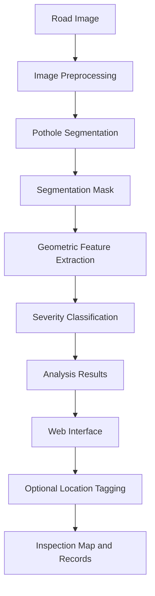

# 🛣️ CrackSight — Pothole Severity Detection

<p align="center">
  <strong>AI-Powered Pothole Segmentation, Geometric Analysis & Severity Classification</strong>
</p>

<p align="center">
  <a href="https://github.com/AnushkaGadhave/pothole-severity-detection">
    
  </a>
  
  
  
  
  
</p>

---

## 📌 Project Overview

Urban roads experience progressive deterioration due to heavy traffic, monsoon conditions, water infiltration, and repeated mechanical stress. Potholes can damage vehicles, compromise commuter safety, and increase municipal maintenance costs.

**CrackSight** is a computer-vision and machine-learning project designed to segment pothole regions in road images, extract geometric characteristics, classify pothole severity, and support location-aware road inspection.

Unlike a system that only determines whether a pothole exists, CrackSight combines image segmentation with feature-based classification to provide a more informative inspection workflow.

### 🎯 Project Objectives

- 🔍 **Pothole Segmentation:** Identify pothole regions using a trained DeepLabV3 segmentation model.
- 📐 **Geometric Feature Extraction:** Analyze segmented regions using shape, area, perimeter, and related image-derived measurements.
- 🧠 **Severity Classification:** Use trained Support Vector Machine (SVM) classifiers to assign provisional severity categories.
- 🗺️ **Geospatial Inspection:** Associate analyzed road defects with user-selected or browser-provided coordinates.
- 🏛️ **Municipal Maintenance Support:** Establish a foundation for road-defect visualization and maintenance prioritization workflows relevant to civic bodies such as the Brihanmumbai Municipal Corporation (BMC).
- 🧪 **Model Evaluation:** Provide scripts and tests for inference, segmentation, severity prediction, and model comparison.

> **Important:** CrackSight is a research and demonstration prototype. Severity labels are not certified engineering assessments, and image-derived measurements are not automatically equivalent to physical road measurements.

## ✨ Key Features

| Feature | Description |
|---|---|
| 🖼️ Image analysis | Submit road images through the web interface for analysis. |
| 🎯 Deep-learning segmentation | Uses a TorchScript-exported DeepLabV3 model with a MobileNetV3-Large backbone. |
| 🔄 Alternative segmentation | Includes a classical Random Forest RGB pixel-segmentation model. |
| 📊 Severity classification | Includes two SVM classifiers using different feature representations. |
| 📐 Geometric analysis | Extracts image-space shape and region characteristics for severity inference. |
| 📍 Location selection | Supports searchable locations, interactive map selection, and optional browser geolocation. |
| 🗺️ Inspection dashboard | Provides a map-oriented workflow for viewing location-tagged inspection records. |
| 🧾 Inspection tracking | Includes severity filters, repair-status workflows, and inspection-data export functionality in the frontend. |
| ⚙️ Python API | Exposes backend endpoints for health checks, model information, and image analysis. |
| 🧪 Evaluation tools | Includes model-benchmarking scripts and inference/API tests. |

## 🔬 System Methodology



The segmentation and severity-classification stages are distinct. Location metadata supports the inspection workflow but is not required for image inference itself.

### 1. 🖼️ Image Preprocessing and Segmentation

The segmentation stage identifies the pothole region within a road image.

The primary segmentation artifact is a TorchScript-exported DeepLabV3 model using a MobileNetV3-Large backbone. A Random Forest-based RGB segmenter is also included as an alternative implementation.

The resulting mask is used by downstream processing to identify the image region associated with the pothole.

### 2. 📐 Geometric Feature Extraction

The project includes feature-processing code for analyzing segmented pothole regions.

| Feature category | Examples | Purpose |
|---|---|---|
| Region geometry | Area and perimeter | Describe the size and boundary of the segmented region in image space. |
| Shape characteristics | Aspect ratio and circularity-related measures | Describe the shape and compactness of the region. |
| Relative features | Relative intensity, mask coverage, and volume-proxy features where applicable | Support the feature representations used by the classifiers. |
| Depth-map-derived features | Relative depth or volume proxies where supported | Provide additional experimental inputs without claiming calibrated physical units. |

Image-space measurements depend on image resolution, perspective, camera position, and segmentation quality. Converting pixel measurements into physical dimensions requires suitable calibration.

### 3. 🧠 Severity Classification

CrackSight includes two serialized SVM-based severity classifiers.

| Model | File | Feature representation |
|---|---|---|
| Model A | `models/svm_rphi_reproducer.joblib` | RPHI-related research/reproduction features. |
| Model B | `models/svm_2d_geometry.joblib` | RGB-derived 2D geometric features for depth-free classification. |

The models use different feature representations and should not be treated as interchangeable. The prediction path determines which features are required.

The severity categories used by the application should be interpreted as **provisional model outputs**, not certified road-condition grades.

## 🧩 Model Architecture and Artifacts

### Segmentation models

| Model | Artifact | Role |
|---|---|---|
| DeepLabV3 + MobileNetV3-Large | `deeplabv3_mobilenetv3.torchscript.pt` | Primary deep-learning segmentation model. |
| Random Forest RGB segmenter | `rgb_segmenter.joblib` | Alternative classical machine-learning segmenter. |

### Supporting metadata

| File | Purpose |
|---|---|
| `models/deeplabv3_metadata.json` | Metadata associated with the exported DeepLabV3 model. |
| `models/segmentation_metadata.json` | Segmentation configuration and related metadata. |
| `models/model_metadata.json` | Metadata associated with severity-classification models. |

The required model artifacts are included in the repository. Experimental checkpoints and backup copies are not required by the basic documented inference workflow.

## 🗺️ Geospatial Inspection Dashboard

CrackSight includes a location-aware inspection workflow in its web interface. The map helps organize analyzed road defects geographically; it does not itself validate the severity prediction.

### 1. 📍 Location Selection

- **Searchable location lookup:** Search for a street, road, or landmark.
- **Interactive map:** Pan and zoom the map and select a location by placing a marker.
- **Marker adjustment:** Refine the selected coordinates using the available map controls.
- **Reverse geocoding:** Resolve coordinates to a human-readable location when the configured provider supports it.
- **Use My Location:** Request browser geolocation only when the user explicitly activates the feature.
- **Optional tagging:** Analyze an image without providing a location.

### 2. 🗺️ Inspection Map and Record Management

The inspection dashboard is designed to support location-tagged road-defect records.

| Capability | Description |
|---|---|
| Severity filtering | Filter inspection records by their predicted severity category. |
| Repair-status tracking | Organize records by maintenance workflow status. |
| Date filtering | Narrow inspection records to a selected time period. |
| Search | Search available inspection details, such as addresses and filenames. |
| Inspection cards | Select a record to focus on its associated map marker. |
| CSV export | Export filtered inspection information where supported by the current frontend implementation. |
| Empty states | Display appropriate interface states when no matching or geotagged records exist. |

Example maintenance statuses include Reported, Under Review, Repair Scheduled, Repaired, and Reopened.

**Data integrity:** The dashboard should display actual inspection records created by the application, not fabricated map pins. A saved inspection, a location-tagged inspection, and a successfully inferred severity are separate concepts and should be represented accordingly.

### 3. 🔐 Privacy and Mapping

- Road images and binary segmentation masks should remain within the image-analysis workflow and should not be sent to geocoding services.
- Location search and reverse-geocoding services may receive search text or coordinate pairs.
- Browser geolocation requires user permission.
- Mapping and geocoding functionality depends on the configured provider and network availability.

If OpenStreetMap tiles are used, retain the required attribution:

`© OpenStreetMap contributors`

Provider-specific configuration should be verified against the current frontend and Vite configuration before deployment.

## 🏛️ BMC Road-Maintenance Use Case

CrackSight can serve as a prototype for a future road-inspection and maintenance-prioritization workflow.

Potential applications include:

- 📍 **Ward-level visualization:** Organize inspected defects by their recorded locations.
- 🚦 **Inspection prioritization:** Use provisional model predictions to help identify locations for further human assessment.
- 🔧 **Maintenance tracking:** Record progress from reporting through repair and subsequent inspection.
- 📈 **Road-condition monitoring:** Support analysis of accumulated inspection records over time.

These are intended use cases, not claims of integration with BMC systems. The repository does not establish a live municipal data feed or an officially validated maintenance-priority score.

## 🏗️ Repository Structure

```text
pothole-severity-detection/
├── app/
│   └── api.py
├── models/
│   ├── deeplabv3_mobilenetv3.torchscript.pt
│   ├── deeplabv3_metadata.json
│   ├── model_metadata.json
│   ├── rgb_segmenter.joblib
│   ├── segmentation_metadata.json
│   ├── svm_2d_geometry.joblib
│   └── svm_rphi_reproducer.joblib
├── public/
│   └── assets/
├── src/
│   ├── evaluation/
│   │   ├── audit_severity_predictions.py
│   │   ├── benchmark_all_models.py
│   │   └── evaluate_multipothole_baseline.py
│   ├── models/
│   │   ├── export_torchscript.py
│   │   ├── inference_service.py
│   │   ├── predict.py
│   │   ├── segmentation.py
│   │   ├── train_deep_models.py
│   │   ├── train_final_model.py
│   │   ├── train_segmenter.py
│   │   └── train_unified_rf.py
│   └── preprocessing/
│       └── build_unified_manifest.py
├── tests/
│   ├── test_api.py
│   ├── test_deeplabv3_inference.py
│   ├── test_inference.py
│   ├── test_segmentation.py
│   ├── test_severity_regression.py
│   └── verify_geospatial_flow.py
├── data/
│   ├── raw/
│   └── processed/
├── index.html
├── app.html
├── app.css
├── app.js
├── main.js
├── location.js
├── style.css
├── package.json
├── package-lock.json
├── requirements.txt
├── vite.config.js
├── README.md
└── CRACKSIGHT_COMPLETE_PROJECT_DOCUMENTATION.md
```

Raw datasets, generated feature tables, temporary experiments, and some local development artifacts may be excluded by `.gitignore`.

## 🚀 Getting Started

### Prerequisites

Install the following:

- Python 3.9 or a compatible version supported by the project dependencies.
- Node.js and npm.
- Git.
- A modern web browser.

The backend also requires the Python dependencies and trained model artifacts used by the inference pipeline.

### 1. Clone the repository

```bash
git clone https://github.com/AnushkaGadhave/pothole-severity-detection.git
cd pothole-severity-detection
```

### 2. Create a Python virtual environment

**Windows PowerShell:**

```powershell
python -m venv .venv
.\.venv\Scripts\Activate.ps1
```

**Linux/macOS:**

```bash
python3 -m venv .venv
source .venv/bin/activate
```

If PowerShell blocks environment activation, use the environment's Python executable directly:

```powershell
.\.venv\Scripts\python.exe -m pip install --upgrade pip
```

### 3. Install Python dependencies

```bash
python -m pip install --upgrade pip
pip install -r requirements.txt
```

### 4. Install frontend dependencies

Open a second terminal at the project root:

```bash
npm install
```

### 5. Start the backend API

From the project root, activate the Python environment and run:

```bash
python -m uvicorn app.api:app --host 127.0.0.1 --port 8000 --reload
```

The backend should be available at:

`http://127.0.0.1:8000`

Check the health endpoint:

```powershell
Invoke-RestMethod http://127.0.0.1:8000/api/health
```

If the API does not start, verify the dependency installation, model files, and error output in the backend terminal.

### 6. Start the frontend

In a second terminal, from the project root:

```bash
npm run dev
```

Open the local URL printed by Vite.

Depending on the current frontend routing and Vite configuration, the landing page and inspection workbench may be available at:

- `/`
- `/app.html`

The Vite development proxy and the frontend API base URL must point to the running backend. For a different deployment environment, configure the API address appropriately.

## ⚙️ Model Training and Inference

### 1. Train the severity classifiers

After obtaining the required dataset and preparing the features expected by the training scripts, run:

```bash
python src/models/train_final_model.py
```

### 2. Train the RGB segmentation model

```bash
python src/models/train_segmenter.py
```

### 3. Train or export deep-learning models

The repository also contains training and export utilities, including:

```text
src/models/train_deep_models.py
src/models/export_torchscript.py
```

These are model-development utilities. Running them may require datasets, compatible library versions, sufficient memory, and additional configuration.

**Training is not required just to use the committed model artifacts.** Avoid rerunning training over existing artifacts unless you intend to replace them and have verified the relevant inputs and outputs.

### 4. Use the Python inference interface

The repository contains `PotholeSeverityPredictor` in `src/models/predict.py`. The following is an illustrative example; the actual input formats and available result fields are defined by the implementation.

```python
from src.models.predict import PotholeSeverityPredictor

predictor = PotholeSeverityPredictor()

# RGB-image prediction
result = predictor.predict_rgb(
    "path/to/road_pothole.jpg",
    return_mask=True,
)

print(result)
```

For mask-only or mask-plus-depth inference, inspect the corresponding methods in `src/models/predict.py` and supply inputs in the formats they require.

Depth-based experimental inputs should not be interpreted as calibrated physical measurements unless calibration has been established independently.

## 🧪 Testing and Evaluation

Run the available test suite from the project root after installing the dependencies:

```bash
python -m unittest discover tests -v
```

The repository includes tests related to:

- API behavior.
- DeepLabV3 inference.
- General inference.
- Segmentation behavior.
- Severity-prediction regression checks.
- Geospatial workflow verification.

Some tests may require model artifacts or additional data. Review any test failures in the context of its prerequisites.

### Evaluation principles

For reproducible model comparisons:

1. Use clearly documented training and test datasets.
2. Keep related or augmented versions of the same source sample within the same data split.
3. Report the evaluation protocol and the exact model artifact.
4. Compare appropriate metrics, such as precision, recall, F1-score, and confusion matrices, when supported by the evaluation script.
5. Distinguish experimental results from validated production results.

This README does not claim an overall accuracy score or a verified performance ranking across all models.

## ⚠️ Scientific Limitations and Proper Interpretation

### 1. Provisional severity labels

The Low, Medium, and High categories should be treated as provisional model outputs unless validated against independent inspection labels and applicable road-engineering standards.

They must not be presented as official BMC maintenance grades or certified pavement-condition classifications.

### 2. Depth maps and physical measurements

Depth-map values may be encoded as grayscale intensities or relative depth values. A grayscale value is not inherently a measurement in millimetres or centimetres.

Without verified sensor calibration, camera geometry, reference surfaces, and suitable ground-truth measurements, the system cannot establish physical pothole depth or volume in units such as cm³ or litres.

### 3. RGB segmentation limitations

The RGB segmentation model identifies image regions and may be affected by:

- Shadows and changes in illumination.
- Asphalt discoloration and road markings.
- Camera angle and image resolution.
- Potholes with irregular boundaries.
- Visual similarity between potholes and other road features.

Segmentation quality should be evaluated separately from severity-classification performance.

### 4. SVM decision scores

SVM decision scores are not automatically calibrated probabilities. They should not be displayed as percentages of confidence unless a suitable calibration method has been implemented and validated.

### 5. Operational use

CrackSight is a prototype for analysis and demonstration. Human review and field verification are necessary before its outputs are used for actual road-maintenance, public-safety, or budget-allocation decisions.

## 🔮 Future Scope

- 📏 Validate severity predictions against independently measured pothole dimensions.
- 📷 Investigate calibrated depth sensors and validated 3D reconstruction.
- 🧪 Expand evaluation across independent road images, weather conditions, and camera types.
- 📍 Improve location-tagged inspection history and map-based analysis.
- 🏙️ Explore ward-level road-condition summaries and maintenance-priority workflows.
- 📊 Add reproducible model-comparison reports and uncertainty analysis.
- 🌐 Prepare a deployment configuration for a hosted frontend and backend.

## 🤝 Contributing

Contributions that improve code quality, reproducibility, testing, documentation, and usability are welcome.

1. Fork the repository.
2. Create a feature branch.
3. Implement and test your changes.
4. Submit a pull request with a clear description.

Please avoid committing secrets, virtual environments, raw datasets, temporary scripts, or unnecessary generated artifacts.

## 📜 License

The project README identifies the project as MIT-licensed. Before distributing the repository, ensure that a `LICENSE` file containing the actual MIT License text is present at the repository root.

## 🔗 Repository

**GitHub:** [AnushkaGadhave/pothole-severity-detection](https://github.com/AnushkaGadhave/pothole-severity-detection)

---

<p align="center">
  <strong>CrackSight — Turning Road Images into Structured Pothole Inspection Insights.</strong>
</p>

<p align="center">
  <sub>Developed as a machine-learning and computer-vision project for road-condition analysis.</sub>
</p>
